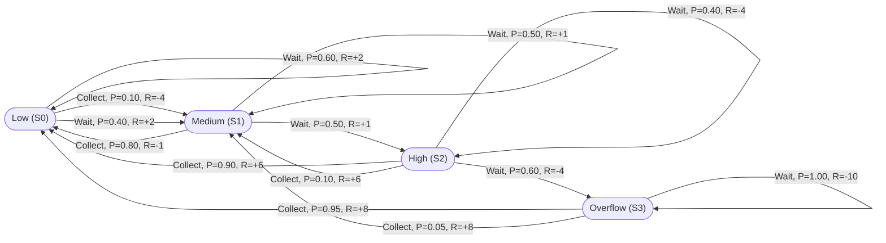

# Representation-of-a-Real-World-Problem-as-a-Markov-Decision-Process


## Aim

> The aim of this project is to represent a smart waste collection system as a Markov Decision Process (MDP) and use the Value Iteration algorithm to determine the optimal time to collect garbage. The system aims to reduce unnecessary collection trips, save fuel and time, and prevent garbage bins from overflowing by choosing the best action based on the current bin's fill level.

---

## Problem Statement

### Problem Description


Waste management is a major challenge in urban areas due to the varying fill levels of garbage bins.
Collecting garbage at fixed intervals can waste fuel, time, and resources.
Delaying collection from nearly full bins may cause overflow and unhygienic conditions.
To solve this problem, a Smart Waste Collection System is represented using a Markov Decision Process (MDP).
The system considers four states: Low, Medium, High, and Overflow.
It has two possible actions: Collect and Wait.
Transition probabilities represent the uncertainty in waste accumulation and changes in bin levels.
A reward function encourages efficient collection and penalizes unnecessary trips and overflowing bins.
The Value Iteration algorithm is used to determine the optimal action for each state.
The goal is to reduce unnecessary collection trips, use resources efficiently, and prevent garbage overflow..


---

## MDP Components

A Markov Decision Process is represented as:

$$
MDP = (S, A, P, R, \gamma)
$$

Where:

| Symbol | Meaning |
|---|---|
| $S$ | Set of states |
| $A$ | Set of actions |
| $P$ | Transition probability function |
| $R$ | Reward function |
| $\gamma$ | Discount factor |

---

## State Space


The state space represents the different fill levels of a garbage bin. The system has four possible states:


```text
S = {
    State 0 - Low,
    State 1 - Medium,
    State 2 - High,
    State 3 - Overflow

}


S0 – Low: The bin is less than 30% full.

S1 – Medium: The bin is 30% to 60% full.

S2 – High: The bin is 61% to 90% full.

S3 – Overflow: The bin is more than 90% full or overflowing.

Therefore, the state space is:

S = {Low, Medium, High, Overflow}
```


---

## Sample State


Sample State: S2 – High

Consider a garbage bin that is 75% full. The system identifies its current state as High (S2). At this stage, the system can choose to collect the garbage or wait. Collecting the garbage helps prevent the bin from overflowing.


---

## Action Space

The action space represents the possible actions the system can take based on the current garbage bin's fill level. The system has two possible actions:

A0 – Collect: The garbage truck collects waste from the bin and reduces its fill level.

A1 – Wait: The system delays collection and allows more waste to accumulate.

Therefore, the action space is:

```text
A = {
    Action 0 - Collect,
    Action 1 - Wait,
    
}
```


---

## Sample Action

If a garbage bin is 75% full (High state), the system can choose Collect (A0) to prevent overflow or Wait (A1) and monitor the bin's condition.


---

## Transition Probability


The transition probability explains how the environment moves from one state to another after an action is taken.

General form:

$$
P(s' \mid s,a)
$$

This means:

> Probability of reaching next state $s'$ after taking action $a$ in current state $s$.


Transition probability represents the likelihood of moving from one garbage bin state to another after performing an action. In this Smart Waste Collection System, the next state depends on the current fill level and the selected action.

The transition probabilities are defined as follows:

| Current State | Action | Next State | Probability |
|---|---|---|---:|
| Low | Collect | Low | 0.90 |
| Low | Collect | Medium | 0.10 |
| Low | Wait | Low | 0.60 |
| Low | Wait | Medium | 0.40 |
| Medium | Collect | Low | 0.80 |
| Medium | Collect | Medium | 0.20 |
| Medium | Wait | Medium | 0.50 |
| Medium | Wait | High | 0.50 |
| High | Collect | Low | 0.90 |
| High | Collect | Medium | 0.10 |
| High | Wait | High | 0.40 |
| High | Wait | Overflow | 0.60 |
| Overflow | Collect | Low | 0.95 |
| Overflow | Collect | Medium | 0.05 |
| Overflow | Wait | Overflow | 1.00 |

**Example:** If the bin is in the High state and the system chooses Wait, there is a 40% probability that it remains High and a 60% probability that it reaches Overflow.

All transition probabilities sum to 1 for each state-action pair. These probabilities are assumed for simulation purposes and can be adjusted using real-world waste collection data.

---

## Reward Function


The reward function defines the feedback received by the agent after taking an action.

General form:

$$
R(s,a,s')
$$


The reward function assigns a numerical reward or penalty for each action taken in a particular garbage bin state. It encourages efficient waste collection, reduces unnecessary trips, and prevents garbage overflow.

The reward values are defined as follows:

| State | Collect | Wait |
|---|---:|---:|
| Low | -4 | +2 |
| Medium | -1 | +1 |
| High | +6 | -4 |
| Overflow | +8 | -10 |

**Explanation:**
- **Low:** Waiting earns a positive reward because immediate collection is unnecessary.
- **Medium:** Waiting earns a small reward while the bin has sufficient capacity.
- **High:** Collecting earns a positive reward because it helps prevent overflow.
- **Overflow:** Collecting earns the highest reward because immediate waste removal is important.
- Waiting when a bin is overflowing receives a large penalty.

These reward values are illustrative assumptions used for the simulation. The system uses them with transition probabilities and the discount factor to determine the optimal policy through Value Iteration.

---

## Graphical Representation


The following MDP graph represents the state transitions of the Smart Waste Collection System. Each node represents a garbage bin state, and each arrow represents an action. The transition probability indicates the likelihood of reaching the next state, while the reward represents the immediate benefit or penalty for taking the action.



### Explanation

- **States:** Low, Medium, High, and Overflow represent the garbage bin's fill levels.
- **Actions:** Collect removes garbage from the bin, while Wait delays collection.
- **Transition probabilities:** These represent the likelihood of moving from the current state to the next state after an action.
- **Rewards:** Positive values encourage desirable decisions, while negative values represent penalties.
- **Optimal policy:** Value Iteration uses the transition probabilities, rewards, and discount factor to determine the best action for each state.

**Note:** The transition probabilities and reward values are assumed for this educational simulation. The immediate reward depends on the current state and selected action, so it remains the same for each possible next state reached through that action.


---

## Python Representation

Write your code here.

Use Python dictionaries to represent the MDP.


```python
# MDP Representation using Python
# print("Name:saiguruchandran g")
# print("Register Number:212223240143")

## Python Representation

# Define the states
states = ["Low", "Medium", "High", "Overflow"]

# Define the actions
actions = ["Collect", "Wait"]

# Define transition probabilities
# P[current_state][action][next_state]

P = {
    "Low": {
        "Collect": {
            "Low": 0.90, "Medium": 0.10,
            "High": 0.00, "Overflow": 0.00
        },
        "Wait": {
            "Low": 0.60, "Medium": 0.40,
            "High": 0.00, "Overflow": 0.00
        }
    },

    "Medium": {
        "Collect": {
            "Low": 0.80, "Medium": 0.20,
            "High": 0.00, "Overflow": 0.00
        },
        "Wait": {
            "Low": 0.00, "Medium": 0.50,
            "High": 0.50, "Overflow": 0.00
        }
    },

    "High": {
        "Collect": {
            "Low": 0.90, "Medium": 0.10,
            "High": 0.00, "Overflow": 0.00
        },
        "Wait": {
            "Low": 0.00, "Medium": 0.00,
            "High": 0.40, "Overflow": 0.60
        }
    },

    "Overflow": {
        "Collect": {
            "Low": 0.95, "Medium": 0.05,
            "High": 0.00, "Overflow": 0.00
        },
        "Wait": {
            "Low": 0.00, "Medium": 0.00,
            "High": 0.00, "Overflow": 1.00
        }
    }
}

# Define the reward function
# R[state][action]

R = {
    "Low": {
        "Collect": -4,
        "Wait": 2
    },
    "Medium": {
        "Collect": -1,
        "Wait": 1
    },
    "High": {
        "Collect": 6,
        "Wait": -4
    },
    "Overflow": {
        "Collect": 8,
        "Wait": -10
    }
}

# Discount factor
gamma = 0.9

# Display the MDP
print("States:", states)
print("Actions:", actions)
print("Discount Factor:", gamma)

print("\nTransition Probabilities:")
for state in states:
    for action in actions:
        print(state, "->", action, ":", P[state][action])

print("\nReward Function:")
for state in states:
    print(state, ":", R[state])

# Verify transition probabilities
print("\nProbability Validation:")
for state in states:
    for action in actions:
        total = sum(P[state][action].values())
        print(state, "-", action, ":", total)
        assert abs(total - 1.0) < 1e-9

print("\nMDP representation created successfully.")


```
---
## Output

```text
States: ['Low', 'Medium', 'High', 'Overflow']
Actions: ['Collect', 'Wait']
Discount Factor: 0.9

Transition Probabilities:
Low -> Collect : {'Low': 0.9, 'Medium': 0.1, 'High': 0.0, 'Overflow': 0.0}
Low -> Wait : {'Low': 0.6, 'Medium': 0.4, 'High': 0.0, 'Overflow': 0.0}
Medium -> Collect : {'Low': 0.8, 'Medium': 0.2, 'High': 0.0, 'Overflow': 0.0}
Medium -> Wait : {'Low': 0.0, 'Medium': 0.5, 'High': 0.5, 'Overflow': 0.0}
High -> Collect : {'Low': 0.9, 'Medium': 0.1, 'High': 0.0, 'Overflow': 0.0}
High -> Wait : {'Low': 0.0, 'Medium': 0.0, 'High': 0.4, 'Overflow': 0.6}
Overflow -> Collect : {'Low': 0.95, 'Medium': 0.05, 'High': 0.0, 'Overflow': 0.0}
Overflow -> Wait : {'Low': 0.0, 'Medium': 0.0, 'High': 0.0, 'Overflow': 1.0}

Reward Function:
Low : {'Collect': -4, 'Wait': 2}
Medium : {'Collect': -1, 'Wait': 1}
High : {'Collect': 6, 'Wait': -4}
Overflow : {'Collect': 8, 'Wait': -10}

Probability Validation:
Low - Collect : 1.0
Low - Wait : 1.0
Medium - Collect : 1.0
Medium - Wait : 1.0
High - Collect : 1.0
High - Wait : 1.0
Overflow - Collect : 1.0
Overflow - Wait : 1.0

MDP representation created successfully.
```

---

## Result


Thus, the Smart Waste Collection System was successfully represented as a Markov Decision Process (MDP) using Python dictionaries. The states, actions, transition probabilities, and reward function were defined and validated successfully. This representation provides the foundation for applying the Value Iteration algorithm to determine the optimal waste collection policy, reduce unnecessary collection trips, and prevent garbage overflow.


---

